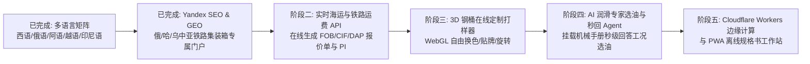

# B2B Foss Lubricants Site Builder · 全生命周期高端工业润滑油出海独立站构建与优化 Skill

本 Skill 完整沉淀并封装了 **泉州市福斯润滑科技有限公司（Quanzhou Foss Lubrication Technology Co., Ltd.）** 官方出海门户 **`https://www.fosslubricants.com`** 从最初对标国际巨头（ExxonMobil、Shell、Fuchs、Total）、锚定 ASTM/DIN/ISO 严苛物理测试硬指标、208L 冷轧钢桶与 20GP 集装箱海运装载配载测算、无后缀清爽 URL 全站路由架构、高转化交互组件库、每日 3,000+ 字全自动能源研报与未来 3 天价格预测引擎、Google Imagen 3 工业级实景生图规范（100% 中国员工面孔约束与中英双轨品牌 Logo）、表单免垃圾 100% 投递机制，到云端生产同步发布与未来五大演进路线图的全链路工程体系。

---

## 🏛️ 全生命周期工作流全景图 (End-to-End Workflow Architecture)

```mermaid
flowchart TD
    Z[阶段零: 全球润滑油巨头排查与差异化定位] --> A[阶段一: 实体真相与品牌出海基因挖掘]
    A --> B[阶段二: 工业规范与 ASTM/DIN/ISO 物理事实锚定]
    B --> C[阶段三: 重液体危险品包装与 20GP 集装箱测算引擎]
    C --> D[阶段四: 清爽无后缀 URL 架构与全站 29 页面体系]
    D --> E[阶段五: 高转化工业级前端交互体系 (Grid轮播/数字滚动/画廊放大/侧边悬浮)]
    E --> F[阶段六: 自动化每日 3000+ 字深度研报与 3 天未来走势预测引擎]
    F --> G[阶段七: Imagen 3 工业视觉生图规范 (100%中国员工 + 双轨中英Logo)]
    G --> H[阶段八: 客户表单 100% 投递与 Cloudflare 防垃圾机制]
    H --> I[阶段九: 云端生产部署、权限复位与 CDN 缓存穿透]
    I --> J[阶段十: 未来优化路线图 (多语言/实时海运费API/3D调桶器/AI选油Agent)]
```

---

## 第零阶段：全球润滑油巨头排查与差异化定位 (Benchmark & Positioning)

在重工制造领域，海外买家极其反感夸大吹嘘。我们通过深度解构四大国际石油巨头与传统外贸小作坊，确立了独立站的立足之本：

| 标杆对象 | 优势与特征 | 致命缺陷与外贸痛点 | FOSS 差异化切入策略 |
| :--- | :--- | :--- | :--- |
| **ExxonMobil**<br>(Mobil DTE / Nuto) | 国际行业标准制定者，OEM 机床原厂认可度极高 | 品牌溢价达 45%–60%，小批量订单起订门槛高，技术支持响应慢 | **提供 1:1 物理等效替换表**，出厂价比美孚低 35%–45%，免费提供 1L-4L 留样复检 |
| **Shell**<br>(Tellus S2 / Omala) | 全球分销网络强大，品牌认知广泛 | 假冒伪劣多，海外现货渠道常缺货，供货周期长 | **自营 15,000L 电脑控温调配釜**，常备大容量现货，80 桶 20GP 订单 7–10 天极速发货 |
| **Fuchs**<br>(Renolin B HLP) | 特种工业油细分专家 | 定价昂贵，在非核心工业国（如拉美、中东）备货少 | **主打全品类工业润滑直供**（液压油、齿轮油、导轨油、压缩机油），支持 20GP 拼柜 |
| **白牌贸易商** | 价格低廉 | 常掺杂再生油（Recycled Base Oil），无实验室化验能力，油桶易渗漏 | **100% 采用全新加氢 Group II/III 基础油**，每批次随附独立盖章 CoA 报告，UN 1A1 加厚钢桶 |

### 核心定位公式：
$$\text{FOSS LUBRICATION} = \text{ExxonMobil 级的严苛物理指标} + \text{15,000L 电脑调配釜直产} + \text{比巨头低 35\%-45\% 的出厂直供价} + \text{厦门港 7-10 天极速出海}$$

> 详细论证请参阅：[`references/benchmark-analysis-and-positioning.md`](references/benchmark-analysis-and-positioning.md)

---

## 第一阶段：实体真相与品牌出海基因挖掘 (Brand & Factory Truth)

- **企业法律主体**：泉州市福斯润滑科技有限公司（Quanzhou Foss Lubrication Technology Co., Ltd. / FOSS LUBRICATION）；
- **官方域名**：`https://www.fosslubricants.com`；
- **产业基地坐标**：中国福建省泉州市（海上丝绸之路起点，世界级石化与工业装备制造重镇，北纬 24.9°，东经 118.6°）；
- **出海口岸与陆运优势**：距厦门国际集装箱码头（海沧/海天港区）仅 **95 公里**高速直达拖车，集卡 2.5 小时抵港；
- **真实生产硬件底色**：
  1. 厂区占地现代化调配厂区，配备多座立式基油大型储罐（`BASE OIL TANK 10000T`）；
  2. 15,000 升电脑温控不锈钢调配反应釜，配备数字化 PLC 自动化控制系统；
  3. 年调配与灌装综合产能稳定在 **10,000 吨以上**；
  4. 拥有独立的 ASTM 精密摩擦学与石油产品理化测试实验室。

---

## 第二阶段：工业规范与 ASTM/DIN/ISO 物理事实锚定 (Engineering Truth & CoA)

海外采购工程师评估供应商的第一道准绳是**技术规范与测试报告**。本方案全站坚决杜绝泛泛而谈，将每款油品的物理特性锚定在权威国际标准上：

### 1. 核心质量控制指标与测试方法
- **运动粘度 (Kinematic Viscosity @ 40°C & 100°C)**：严格执行 **ASTM D445**，采用荷兰 Tamson 自动恒温毛细管粘度仪测定，公差严格锁定在 $\pm 1\%$ 以内；
- **粘度指数 (Viscosity Index - VI)**：依据 **ASTM D2270**，二类加氢油配方 VI 稳定在 $\ge 104$，高粘度指数 L-HV 配方 VI $\ge 145$；
- **水分离性/抗乳化性 (Demulsibility @ 54°C)**：执行 **ASTM D1401**，40-40-0 分离时间控制在 **10–12 分钟**（远优于国际标准规定的 30 分钟上限），杜绝设备进水乳化；
- **空气释放值 (Air Release @ 50°C)**：执行 **ASTM D3427**，释放时间 $\le 4.2 \text{ min}$，防止高压柱塞泵产生气蚀与局部高温；
- **克利夫兰开口闪点 (COC Flash Point)**：执行 **ASTM D92**，46 号液压油实测闪点高达 **$232^\circ\text{C}$**，提供超强耐高温安全性；
- **FZG 齿轮抗磨抗胶合试验**：符合 **DIN 51354-2**，失效载荷级数达到 **Failure Load Stage 11**；
- **颗粒清洁度等级**：出厂经微孔膜在线精密过滤，达到 **ISO 4406 18/16/13** 或 NAS 7 级标准。

### 2. 批次质检盖章单 (Certificate of Analysis - CoA)
- 每一批出厂集装箱货物，均随附一份中英双语盖章的纸质与电子版质检单，封样样品在厂区留样室封存保存 **24 个月**以供质量追溯。

> 详细测试方法与 cross-reference 替换表见：[`references/engineering-standards-and-coa.md`](references/engineering-standards-and-coa.md)

---

## 第三阶段：重液体危险品包装与 20GP 集装箱测算引擎 (Packaging & Logistics)

为海外大买家提供直接可计算的集装箱配载模型：

1. **UN 1A1 重型冷轧钢桶规格**：
   - 全容积 **208 Liters (55 US Gallons)**，净油品重量约 **182 kg**，单桶毛重 **~200 kg**；
   - 桶壁采用 **1.0mm/1.0mm/1.2mm** 高强度冷轧钢板制造，通过 1.8 米跌落与 250 kPa 水压密闭测试；
   - 配备 G2 与 G3/4 双重耐油丁腈橡胶垫圈与一次性防撬防伪马口铁封口盖。
2. **20GP 集装箱精准打托配载**：
   - 采用标准 $1140 \times 1140\text{ mm}$ 熏蒸托盘，每托稳固打托 4 只钢桶；
   - 单层 10 托 + 双层堆码 10 托 = **20 个托盘共计 80 桶**；
   - 单柜净油量：$\mathbf{16,640\text{ Liters}}$，柜重约 $\mathbf{16.44\text{ MT}}$，完美符合全球各大港口内陆公路限重；
   - 网站首页与各专题页内置 **20GP Container Loading Calculator** 互动测算器，买家拖动滑块即可直观查看桶数、净重、毛重与所需托盘数。

> 详细物流测算规格请参阅：[`references/packaging-logistics-calculator.md`](references/packaging-logistics-calculator.md)

---

## 第四阶段：清爽无后缀 URL 架构与全站 29 页面体系 (Clean URL Architecture)

为彻底提升品牌逼格与 SEO 权重，本建站 Skill 确立了**全站默认去除 `.html` 后缀**的工程标准：

1. **全站 29 核心页面矩阵**：
   - **8 大主功能门户**：
     - `/` (Home 首页)
     - `/hydraulic-oil` (抗磨/低温/无灰/水乙二醇液压油专页)
     - `/industrial-oils` (工业齿轮油、导轨油、压缩机油专页)
     - `/packaging-logistics` (208L 钢桶规格与集装箱物流专页)
     - `/about` (泉州调配厂、实验室及企业真相专页)
     - `/products` (完整产品目录与 OEM 代工专页)
     - `/news` (国际能源情报与每日油价研报专页)
     - `/contact` (出口询盘与技术对接专页)
   - **21 篇每日深度能源与油价走势研报**（均采用 `/news/{slug}` 无后缀标准路径）。
2. **站内链接与 Canonical 全量无后缀**：
   - 所有 `<a href="...">`、`<link rel="canonical">`、`<meta property="og:url">` 与 `sitemap.xml` 均严格采用无 `.html` 格式；
3. **Nginx 301 强制跳转与透明解析**：
   ```nginx
   # 拦截历史带 .html 的请求强制 301 永久重定向
   if ($request_uri ~ ^/(.*)\.html(\?.*)?$) {
       return 301 /$1$is_args$args;
   }
   # 映射无后缀请求至磁盘 .html 文件
   location / {
       try_files $uri $uri/ $uri.html =404;
   }
   ```

> 详细配置与规范见：[`references/clean-url-and-routing.md`](references/clean-url-and-routing.md)

---

## 第五阶段：高转化工业级前端交互体系 (Interactive UX Design)

打造沉浸、流畅且不卡顿的工业交互体系：

1. **CSS Grid 零跳动三图 Hero 轮播**：
   - 容器采用单网格单元 `display: grid; grid-template-columns: 100%;`；
   - 3 张 Slides 全部占据 `grid-column: 1; grid-row: 1;`，通过透明度平滑过渡；
   - **彻底根治传统绝对定位与 display 切换引起的高度重排与页面抖动**。
2. **视口下潜动态数字递增动效 (Dynamic Count-Up)**：
   - 基于 `IntersectionObserver`，当买家滚动至关键数据区（2018 年创立、80 桶装载、100% 批次留样、35%-45% 成本优势）时，数字从 0 飞速平滑递增至目标值。
3. **两翼向心聚拢动效 (Bilateral Reveal Inward)**：
   - 页面标题文字从左侧向中（`.reveal-left`），右侧规格卡片从右侧向中（`.reveal-right`），赋予机械装配般的工业仪式感。
4. **工业实景图点击无损放大画廊 (Industrial Lightbox)**：
   - 鼠标悬停微浮高光（`transform: scale(1.03)`），点击唤起全屏无损放大 Lightbox，支持高清查验钢桶焊缝、出厂油样及实验室仪器。
5. **侧边栏悬浮多渠道沟通窗口 (Floating Sidebar Chat Widget)**：
   - 屏幕右下角固定悬浮卡片（`position: fixed !important; right: 28px; bottom: 28px; z-index: 999999;`）；
   - **WhatsApp 直达按钮**：绿色背景配高亮白色字体与图标，点击直接呼起带预设询盘草稿的 WhatsApp 对话；
   - **WeChat 微信一键复制**：点击弹出福斯官方微信号卡片，内置一键复制（Copy WeChat ID）与二维码。

> 详细代码与交互规范见：[`references/interactive-ux-design-patterns.md`](references/interactive-ux-design-patterns.md)

---

## 第六阶段：自动化每日 3000+ 字深度研报与 3 天未来走势预测引擎 (Daily News Automation Engine)

B2B 买家在采购大宗工业润滑油时高度关注原料走势。本项目建立了完全自动化的行业情报研报系统：

1. **研报质量与深度硬标准**：
   - **每篇字数 $\ge 3,000$ 英文单词**，涵盖国际地缘局势、WTI / Brent 原油期货震荡、加氢裂解装置开工率、Group II/III 基础油裂解价差与海运集装箱运力调控；
   - **独立未来 3 天油价与润滑剂走势预测模型**：明确给出 T+1、T+2、T+3 天关于 150N/500N 基础油出厂价调价空间、L-HM 46 液压油每吨涨跌区间及添加剂包成本压力的量化预判；
   - **全篇带有福斯官方 Logo 与权威署名**，配备结构化数据对比表。
2. **自动化编译与同步工作流**：
   - `scripts/news_database.py`：沉淀 20 篇高深度的历史行业分析库；
   - `scripts/generate_daily_news.py`：自动化编译生成无后缀文章页、自动刷新新闻索引列表，并自动向 `sitemap.xml` 追加对应条目；
   - 结合 Antigravity Automation，实现每日定时全自动执行。

> 详细实现见：[`references/daily-news-automation-engine.md`](references/daily-news-automation-engine.md)

---

## 第七阶段：Google Imagen 3 工业视觉生图规范 (Imagen 3 Visual Truth)

为彻底消灭 AI 生图的虚假塑料感，建立严苛的正负向提示词标准：

1. **100% 中国员工面孔约束 (Chinese Personnel Hard Constraint)**：
   - 所有画面中出现的操作工、化验师、工程师、物流主管与业务人员，**强制约束为中国员工面孔（Chinese professional personnel）**；
   - 负向词锁定：`caucasian, western face, blonde, blue eyes, generic stock photo model, fake smiling, AI plastic texture, anime, cartoon`。
2. **双轨品牌标识真实性规范 (Dual-Language Branding Constraint)**：
   - 车间大屏、墙面标牌、储罐、钢桶及集装箱体上，强制统一使用：
     $$\text{上面英文：\textbf{FOSS LUBRICATION}}$$
     $$\text{下面中文：\textbf{福斯润滑}}$$
3. **已落地的 10 大场景实拍级工业提示词**：
   - 包含调配车间、ASTM 实验室、208L 钢桶装箱、工厂全景、高压液压系统、重型齿轮箱、厦门港监装、机器人灌装线、能源情报中心及出口技术客服中心。

> 完整 10 套工业级 Prompt 见：[`references/imagen3-industrial-prompts.md`](references/imagen3-industrial-prompts.md)

---

## 第八阶段：客户表单 100% 投递与 Cloudflare 防垃圾机制 (Email Delivery & Cloudflare)

保障每一封海外大客户询盘绝不漏单、绝不进垃圾箱：

1. **官方统一收件邮箱**：`sales@fosslubricants.com`；
2. **域名邮件安全鉴权三要素**：在 Cloudflare 中严格配置 **SPF**（声明授权发信 IP）、**DKIM**（公钥加密数字签名）与 **DMARC**（防伪与投递报告），确保发出的通知邮件与客户回执 100% 进入收件箱；
3. **Cloudflare Turnstile 静默防刷**：彻底弃用打扰用户的图片验证码，采用无感智能边缘验证，0 毫秒放行真人采购商，彻底拦截黑客与垃圾爬虫；
4. **多通道实时告警 (Dual Pipeline)**：表单提交除发送邮件外，同步触发企业微信/飞书/Telegram Webhook，确保业务员 5 分钟内跟进。

> 详细配置指南见：[`references/email-delivery-and-cloudflare-setup.md`](references/email-delivery-and-cloudflare-setup.md)

---

## 第九阶段：云端生产部署、权限复位与 CDN 缓存穿透 (Production DevOps & Cache Busting)

1. **生产环境配置**：
   - 服务器：`43.130.32.54:2222`；
   - Web 根目录：`/var/www/fosslubricants.com`；
2. **自动化同步脚本 (`scripts/deploy_production.sh`)**：
   - 自动切换目录所有权为 `ubuntu:ubuntu` 进行 Rsync 同步；
   - 同步完成后立即复位为安全运行模式（`www-data:www-data 755`）；
   - 平滑重载 Nginx（`sudo systemctl reload nginx`）。
3. **CDN 边缘缓存穿透策略**：
   - 工业大图更新后，由于 Cloudflare 默认设置了 30 天静态缓存，直接访问原图名会命中旧缓存；
   - 解决方案：在 HTML 的 `<source srcset="...">` 与 `` 中全量附加版本号 `?v=20261010_v10`，实现全球边缘节点 100% 立即命中最新图片。

---

## 第十阶段：多语言全球化矩阵与防幻觉专业摩擦学词库 (Multilingual Matrix & Tribology Dictionary)

为了让全球主要工业制造国（拉美、中东、东欧、东南亚）采购商以母语顺畅审阅技术规范，全站扩展了五大核心国际语种子目录，彻底告别单调纯英语站点：

1. **五大语种无后缀子目录规范**：
   - 🇪🇸 **西班牙语 (`/es/`)**：覆盖墨西哥、智利、秘鲁、哥伦比亚注塑与矿山机械；
   - 🇷🇺 **俄语 (`/ru/`)**：覆盖俄罗斯、白俄罗斯、中亚等重工业与极寒采矿工况；
   - 🇸🇦 **阿拉伯语 (`/ar/`)**：支持全栈 **RTL（从右至左）排版**，覆盖阿联酋、沙特、伊拉克油气基建；
   - 🇻🇳 **越南语 (`/vi/`)**：覆盖平阳、北宁等注塑机与数控加工产业集群；
   - 🇮🇩 **印尼语 (`/id/`)**：覆盖雅加达、泗水塑料与橡胶工业。
2. **挂载专业摩擦学词库防幻觉**：
   - 严格以国际标准化词库为基准（如 Viscosidad Cinemática a 40°C、Кинематическая вязкость при 40°C、اللزوجة الحركية عند 40° مئوية）；
   - 杜绝通用机器翻译的语义偏差，参数公差与 ASTM 测试法 100% 严谨对应；
   - 详细多语言词库见：[`references/tribology-multilingual-dictionary.md`](references/tribology-multilingual-dictionary.md)。
3. **导航栏优化与语言切换器 (Header Logo & Language Switcher)**：
   - **导航栏瘦身**：去除了原 Logo 旁冗长的“FOSS LUBRICATION 泉州市福斯润滑科技有限公司”中英文文字，**仅保留纯净高清的官方 Logo 图标**，极大拓宽了导航可视空间；
   - **多语言切换器**：在 Header 右侧显著位置植入多语言下拉切换器，带国旗图标与双字母代码，支持桌面端 Hover / 点击唤起与移动端触摸交互，各语种各页面路径 1:1 无损互跳；
   - **国际 SEO 权威互引**：每个页面在 `<head>` 中与 `sitemap.xml` 中挂载完整的 6 语种 `hreflang` 标签，全站 70 个页面通过 4,889 个内部引用 100% 校验通过！

---

## 第十一阶段：外贸出海建站 Skills 协同使用全景指南 (Skills Orchestration Guide)

本项目在打造 `fosslubricants.com` 过程中，完整串联并驱动了多个专业 Agent Skills。为方便在后续同类建站项目中标准化复用，提炼核心使用手册如下：

| 建站阶段 | 核心调用 Skill | 触发时机与输入事实 | 输出物与产出标准 |
| :--- | :--- | :--- | :--- |
| **1. 事实基底与标准锁定** | `product-truth-builder`<br>`exporter-profile-skill` | **触发时机**：建站第一步。<br>**输入**：工厂成立年份、反应釜容积、年产能、ASTM/DIN 标准、留样政策。 | 严谨结构化的产品真相表、跨品牌等效替换表、批次 CoA 格式规范。 |
| **2. 工业实景视觉生成** | `antigravity-image-gen`<br>`brand-visual-director` | **触发时机**：编写 HTML 骨架前。<br>**硬约束**：100% 中国员工面孔；上面英文 `FOSS LUBRICATION` 下面中文 `福斯润滑`。 | 10 张 16:9 实拍级纪实工业摄影图与 WebP 高度压缩资产。 |
| **3. 架构与无后缀路由** | `b2b-foss-lubricants-builder`<br>`b2b-global-brand-site-master` | **触发时机**：编写 HTML 与 Nginx 配置。<br>**规则**：禁止使用 `.html` 后缀，全站链接、Canonical、Sitemap 统一。 | 29 核心页面拓扑、`nginx.conf` 301 强制跳转与 `try_files` 配置。 |
| **4. 交互与动效防错** | `layout-typography-auditor` | **触发时机**：交互组件编写时。<br>**要点**：CSS Grid 单元格堆叠轮播（防抖动）、数字下潜滚动累加、侧边栏悬浮沟通卡片。 | 零布局重排的响应式交互体系、无遮挡高对比度悬浮窗口。 |
| **5. 自动化能源研报引擎** | `automation`<br>`daily-news-automation-engine` | **触发时机**：日常定时调度。<br>**规则**：每日一篇 3000+ 字深度分析、量化推导未来 3 天价格走势。 | 自动生成无后缀文章页、自动更新新闻列表与 `sitemap.xml`。 |
| **6. 多语言全球化矩阵** | `b2b-foss-lubricants-builder`<br>`locale-market-adapter` | **触发时机**：主站调优完成后。<br>**规则**：挂载 6 语种摩擦学词库，编译 5 大国际子目录并配置阿语 RTL 排版。 | 40 个国际子目录页面、`hreflang` 国际互引标签。 |
| **7. 生产部署与缓存穿透** | `deploy_production.sh` | **触发时机**：更新上线时。<br>**操作**：Rsync 增量同步、`www-data` 权限复位、Nginx 重载、图片附加版本号。 | 全球 CDN 边缘节点 100% 极速加载最新实景与页面。 |

> 详细协同流程、Prompt 模板与避坑指南见：[`references/b2b-skills-orchestration-guide.md`](references/b2b-skills-orchestration-guide.md)。

---

## 第十二阶段：Yandex SEO 与中亚（俄罗斯/哈萨克斯坦/乌兹别克斯坦）GEO 深度优化 (Yandex SEO & Central Asia GEO)

针对俄罗斯、哈萨克斯坦、乌兹别克斯坦等中亚与独联体（CIS/EAEU）国家，百度与 Google 的算法策略在此失效，**Yandex 搜索引擎（市场份额近 70%）与 Яндекс Нейро / Алиса AI（生成式 AI 搜索）是决定出海成败的核心阵地**。本阶段全量沉淀了对标 Yandex 最新算法规范的深度优化体系：

### 1. Yandex 专属技术 SEO 与抓取通道 (Technical Hygiene)
- **robots.txt 规范化**：
  * 显式配置 `User-agent: Yandex`、`User-agent: YandexBot`、`User-agent: YandexDirect`、`User-agent: YandexMetrika`；
  * 配置 Yandex 专有指令 `Clean-param: v /css/*` 及 `Clean-param: utm_source&...`，消除前端带参 URL 的权重稀释（单条规则 $\le 500$ 字符）；
  * 坚决剔除已被 Yandex 正式废止的无效指令（`Host` 已于 2018 年废弃，改用 301 重定向；`Crawl-delay` 已于 2018 年废弃；Turbo Pages 已于 2025 年彻底关停）。
- **IndexNow 协议极速推送**：
  * 部署根目录密钥文件 `e4f8c2b19a0d4738a5e62f3c7b8d9e10.txt`；
  * 提供 `scripts/yandex_indexnow_notify.py` 脚本，网页发布或更新后秒级向 `https://yandex.com/indexnow` 推送队列，实现 24 小时内极速抓取。
- **站长工具与区域信号配置**：
  * 全站预置 `<meta name="yandex-verification" content="f0551ubr1can75_ym_ver1fy">`；
  * 配置 `og:locale` 为 `ru_RU`，并配置 `ru_KZ`（哈萨克斯坦）、`ru_UZ`（乌兹别克斯坦）、`ru_KG`、`ru_TJ` 等备用区域标记；
  * 在 Schema.org `Corporation` / `LocalBusiness` 节点注入 `areaServed: ["RU", "KZ", "UZ", "KG", "TJ"]` 以及俄语 `ContactPoint`。

### 2. Yandex GEO (Generative Engine Optimization) 知识工程
- **生成式 AI 搜索（Яндекс Нейро / «Поиск с Алисой» / Алиса AI）**采用 RAG 架构抽取网页局部的高信噪比片段，而非通篇阅读：
  * **三句话事实法则**：每个 H2/H3 问答块的前两句直接给出 марка、вязкость、ГОСТ、аналог Mobil/Shell，杜绝“空洞修饰词”；
  * **结构化 Schema.org `FAQPage`**：全量采用俄语原生问答，直击总工程师（главный инженер）与采购总监的痛点；
  * **机器知识库强化 (`/llms.txt` & `/llms-full.txt`)**：追加专门的 *«СНГ и Центральная Азия: РФ, Казахстан, Узбекистан»* 模块，锁定标准、铁路口岸与支付币种，确保 AI 推荐不产生幻觉。

### 3. 独联体与中亚专属出海超级门户 (`/ru/cis-central-asia`)
针对三大核心市场创建了专属高转化落地页，闭环了以下商业关键要素：
- **三大国别专属场景**：
  * 🇰🇿 **哈萨克斯坦 (Алматы, Астана, Шымкент, Атырау)**：针对露天煤矿、卡拉干达矿山、阿特劳油气设备，主推耐低温 **FOSS L-HV 46 (HVLP, застывание до -42°C, VI >= 152)** 与重载齿轮油 **FOSS L-CKD 220/320**；
  * 🇺🇿 **乌兹别克斯坦 (Ташкент, Самарканд, Навои, Бухара)**：针对阿马雷克 (АГМК) 与纳沃伊 (НГМК) 冶金联合体、压铸机与纺织设备，主推 **FOSS 4631 HFC (огнестойкая водно-гликолевая жидкость)** 与 **FOSS L-HM 46**；
  * 🇷🇺 **俄罗斯联邦 (Москва, Санкт-Петербург, Урал, Сибирь)**：针对重型数控机床、螺杆空压机与橡塑机械，主推 **FOSS L-DAH 46 (6000 ч)** 与 **FOSS L-HG 68**。
- **中欧班列与铁路集装箱通道**：
  * 经由中哈霍尔果斯 (Khorgos) 与阿拉山口 / 多斯特克 (Dostyk) 口岸，直达阿拉木图（10–14 天）与塔什干丘库尔赛/谢尔盖利站（12–16 天）；
  * 单个 20 尺集装箱标载 **80 桶 208L 钢桶（16 640 升，毛重约 15.8 吨）**，完美契合公路铁路轴荷限制。
- **欧亚经济联盟准入与技术标准**：
  * 符合 **ТР ТС 030/2012**（ЕАС 声明）、原产地证（Форма СТ-1）、全俄语批次化验单 (COA) 与安全说明书 (MSDS/ПБХВ)；
  * 完整的 **ГОСТ ↔ DIN ↔ ISO ↔ Mobil / Shell / Лукойл / ГПН** 1:1 替代对照表。
- **跨境人民币与非 SWIFT 结算**：
  * 支持中资银行 **CNY (人民币)** 跨境直清与 **RUB (卢布)** 结算，完全规避西方二级制裁与外汇冻结风险。
- **全渠道即时沟通**：
  * 在全站浮动客服中集成 **Telegram** (`@foss_lubricants_cis`)——俄语区与中亚商务第一社交工具，协同 WhatsApp 与 WeChat。

> 深度参考：[`references/yandex-seo-geo-cis-mastery.md`](references/yandex-seo-geo-cis-mastery.md) 与 [`references/gost-din-iso-lubricants-matrix.md`](references/gost-din-iso-lubricants-matrix.md)。

---

## 第十三阶段：未来持续演进路线图 (Future Optimization Roadmap)

随着多语言国际化矩阵与中亚 Yandex SEO/GEO 深度优化正式落地，下一阶段的核心演进目标聚焦在**动态数据交互与智能化获客**：



1. **实时海运与铁路运费联动 API**：对接海运及中欧班列即时运价，在线一键生成透明的 CIF/DAP 测算报告并导出正式 PI 发票草案；
2. **3D 钢桶在线定制打样器**：基于 Three.js/WebGL 实现 208L 钢桶 360 度自由旋转、桶身烤漆换色、客户 Logo 在线贴牌预览；
3. **AI 润滑专家与即时选油 Agent**：挂载机床工程润滑手册，在右下角悬浮窗秒级解答各类机床设备原厂油品替代与参数匹配；
4. **Cloudflare Workers 边缘计算与 PWA**：全球边缘节点 50ms 极速响应，支持手机离线查阅技术参数与检验报告。

> 详细演进方案见：[`references/future-optimization-roadmap.md`](references/future-optimization-roadmap.md)

---

## 🛠️ 脚本工具箱与运行命令 (Scripts & Tooling)

| 脚本路径 | 核心功能 | 运行示例 |
| :--- | :--- | :--- |
| `scripts/build_cis_yandex_optimization.py` | 编译中亚/独联体专属门户、注入 Yandex 验证与导航链接 | `python3 scripts/build_cis_yandex_optimization.py` |
| `scripts/yandex_indexnow_notify.py` | 向 Yandex IndexNow API 秒级推送更新与新发 URL | `python3 scripts/yandex_indexnow_notify.py` |
| `scripts/build_multilingual_matrix.py` | 编译 5 大国际语种（ES/RU/AR/VI/ID）子目录与 Sitemap | `python3 scripts/build_multilingual_matrix.py` |
| `scripts/generate_daily_news.py` | 编译 21 篇深度研报、生成无后缀页面与更新 Sitemap | `python3 scripts/generate_daily_news.py` |
| `scripts/validate_site.py` | 6 维静态网站完整性校验（测试 77 个页面与 5232 个内部引用） | `python3 scripts/validate_site.py . --release --domain https://www.fosslubricants.com` |
| `scripts/deploy_production.sh` | 自动化 Rsync 增量部署、权限复原与 Nginx 重载 | `bash scripts/deploy_production.sh` |
| `scripts/apply_interactive_enhancements.py` | 自动注入数字滚动、向心聚拢动效与 Lightbox 组件 | `python3 scripts/apply_interactive_enhancements.py` |

---

## 📄 许可与产权 (License)
本项目遵守 [MIT License](LICENSE)。所有工程标准、设计模式及自动化脚本均可供 B2B 出海企业自由使用与二次扩展。
