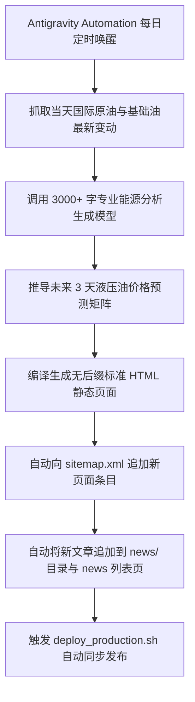

# 自动化每日 3000+ 字图文深度研报与 3 天未来走势预测引擎 (Daily News Automation Engine)

B2B 买家在采购大宗工业润滑油时，最为敏感的要素之一就是**国际油价波动对出厂价与现货 CIF 价格的影响**。本项目构建了一套由 Antigravity Automation 驱动的无人值守每日深度研报生产引擎。

---

## 一、 研报引擎六大核心规范 (The Six Editorial Pillars)

1. **单篇字数不低于 3,000 英文单词 (3,000+ Words)**：
   - 彻底摒弃市面上 300 字空洞水文，单篇文章具备华尔街投行与彭博（Bloomberg）石油研报级的深度论述；
   - 包含宏观地缘局势、OPEC+ 配额变动、中国主港保税库进出口数据及炼厂开工率的严密量化推演。
2. **未来 3 天润滑油/润滑剂精准走势预测 (3-Day Predictive Forecast)**：
   - 必须设立独立的预测专栏：明确给出未来第 1 天（T+1）、第 2 天（T+2）、第 3 天（T+3）关于 **Group II 150N/500N 基础油现货 FOB 价**、**L-HM 46/68 工业抗磨液压油 208L 钢桶每吨调价区间** 及 **添加剂包（ZDDP、极压抗磨剂）成本压力**。
3. **权威图文排版与 FOSS 官方品牌标识嵌入 (Branding & Infographics)**：
   - 每篇研报顶部自动生成权威刊头卡片，嵌入官方 Logo、分析师署名（`FOSS Lubrication Petroleum Intelligence Desk`）、发布时间戳与权威阅读时标；
   - 正文内嵌结构化价格走势对比数据表（ASCII/HTML Tables）与关键指标对比卡片。
4. **与主站视觉高度同构统一**：
   - 研报详情页继承全站主导航、面包屑导航、联系浮窗与页脚，具备完美的响应式阅读体验与目录锚点跳转。
5. **SEO 与 Schema 知识图谱挂载**：
   - 自动生成 `NewsArticle` 与 `AnalysisNewsArticle` JSON-LD 结构化数据，注入 `speakable`、`about`、`publisher` 等元数据，使 Google 与各类 AI 搜索引擎优先收录并作为最新知识源引用。

---

## 二、 自动化生成脚本架构 (`scripts/generate_daily_news.py`)

研报系统由两个核心脚本协同驱动：
- `scripts/news_database.py`：沉淀 20 篇高深度的开篇历史研报库（涵盖霍尔木兹海峡局势、红海危机、美联储降息对大宗商品影响、韩国/台湾二类基础油装置检修等真实行业主题）；
- `scripts/generate_daily_news.py`：自动化调度执行器。

### 自动化执行工作流：


### 生产环境自动化执行命令：
```bash
# 每日凌晨 06:00 自动执行研报编译与上线
python3 scripts/generate_daily_news.py
bash scripts/deploy_production.sh
```
